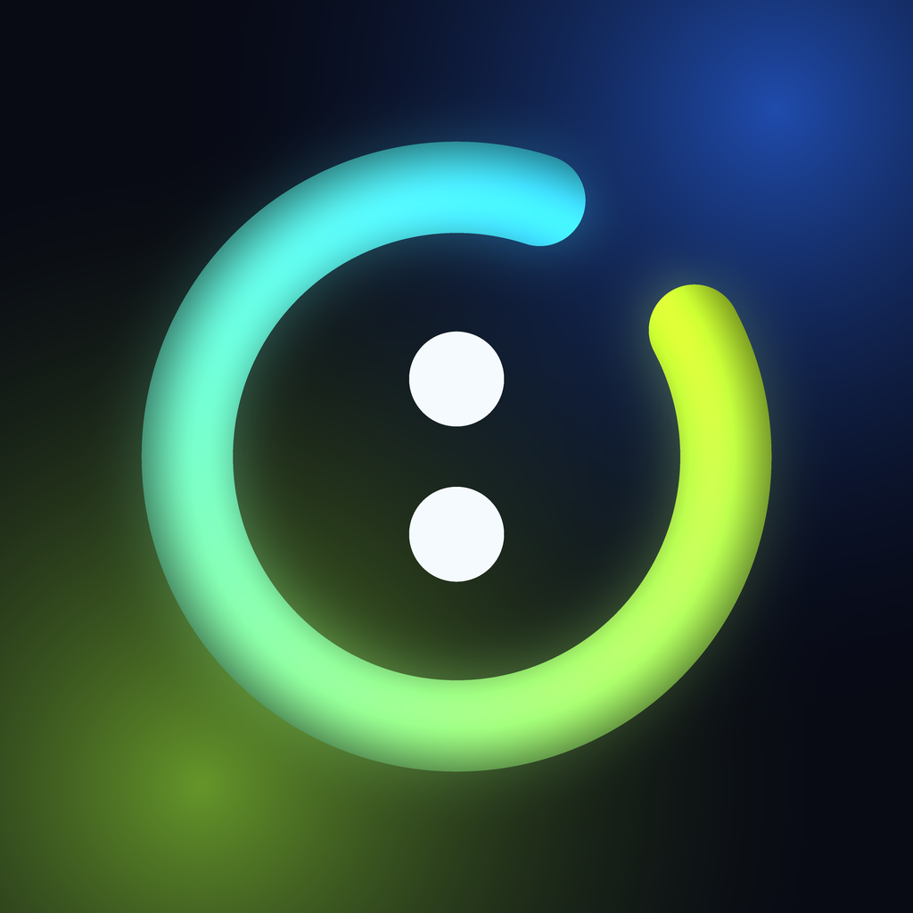

<p align="center">
  
</p>

<h1 align="center">RE:SET AI</h1>

<p align="center">A health app for a hectic schedule. It tracks by itself and tells you one next step.</p>

<p align="center">
  Source available. All rights reserved.
</p>

## Overview

Native iPhone app. SwiftUI, SwiftData, local first. No account, no server. Your phone collects the data. Rules turn it into guidance. AI only helps read food and answer chat.

Design rule: the app removes work. It never adds it.

* Work, university and gym time record themselves from places you save. Step out and come back the same day and the session continues.
* Steps, workouts and sleep come from Apple Health. Steps ignore time spent driving or cycling, so a bus or scooter ride does not count as walking.
* Sleep comes from Health. With no watch or tracker, the app estimates last night from the longest overnight stretch with no steps, and labels it as an estimate. Real Health data or a typed entry replaces it.
* Food is logged by describing it, photographing it or scanning a barcode.
* Reminders follow your own habits, such as the time you usually eat lunch. If sleep, food or water is still empty, one gentle nudge asks. Logging cancels it.
* Missing data shows as missing. Nothing is guessed. Nothing is shaming.

## Features

### Today
* One priority sentence.
* Food first: calories left, protein, carbs and fat against your guide.
* Water and sleep next, side by side. Tap water to add a glass.
* One small strip for recovery and steps.
* Work, university and gym rows, only if you use them. Each shows start to end and the total, for example `09:02 to 17:40` and `8h 38m`.
* Floating log bar: describe, photo, barcode. A plate with several dishes logs every dish.

### Activity
* Steps with a weekly chart, walk timer, workouts imported from Health.
* Workout, Sleep and Work and university in one list. Recent sessions below.

### Nutrition
* Food summary as on Today.
* One line for the next meal. Carb heavy day suggests protein. High fat suggests lean. Over the guide suggests a light meal.
* Water with quick add buttons. Caffeine and Can I eat this? in one list. Caffeine from any logged drink is added by itself.
* Today's meals, editable.

### Insights
* This week: sleep, steps and workouts.
* Steps and sleep charts for the week against your goals.
* Patterns found in your own data, such as sleep after long work days and sleep after training. Shown only with enough days.
* Weight trend.

### Coach
* Chat that reads your data through a fixed set of tools. It cannot delete anything. Simple questions work with no AI.

### Also
* Widgets: Home Screen, Lock Screen, quick action.
* Siri and Shortcuts: log water.
* Dark, flat design. Solid cards, hairline edges, one lime accent. Muted data colours for food, water, sleep and macros.

## How it works

* Places: search a name such as your gym or office. iOS region monitoring reports arrive and leave. No route is recorded.
* Gym visit of 20 minutes or more becomes a strength workout.
* Health wakes the app when a workout or sleep night arrives. It imports and removes duplicates.
* Meal reminders move to the median time you ate that meal over the last 21 days, after 3 logs.
* Calorie target: Mifflin St Jeor, activity multiplier, capped deficit. Protein default is 1.8 g per kg.
* Everything calorie related is an estimate and is labelled as one.

* Recovery is a rule based lifestyle indicator with a 0 to 100 score. It blends recent sleep, yesterday's food, water and steps, plus workload, hard sessions and check-ins. Signals with no data are left out, never guessed. One strained signal never makes it Low.

## Install

Needs Xcode 16 or newer and an iPhone running iOS 17 or newer.

```sh
open RESET.xcodeproj
```

1. Select the RESET target, Signing and Capabilities, choose your Team.
2. Change the bundle identifier to something unique.
3. Add the App Groups capability to both RESET and RESETWidgets with `group.com.rayyan.reset`. If you change the id, change it in `Shared/WidgetShared.swift` and both entitlement files.
4. Confirm HealthKit and Background Modes (Location updates, Background fetch).
5. Run on a simulator or a connected iPhone.

Geofence arrivals, Health data and the camera need a real iPhone. A free Apple ID works and expires after seven days.

## Test

```sh
cd ResetCore
xcodebuild test -scheme ResetCore -destination 'platform=macOS'
```

Backend proxy tests, if you use it: `cd backend && uv run pytest`.

## AI setup

AI is off until you allow it. Open Settings, AI and data sources, pick a provider, add your key, then turn on "Allow sending". Keys are stored in the iOS Keychain on the phone.

* Anthropic: default model `claude-haiku-5-5`, editable.
* OpenAI or compatible: you enter the model name. It must accept images.
* Proxy: your own https server holds the key. See `backend/`.

The client retries rate limits and overloaded replies with a short backoff, and shows the provider's own error message when a request is refused, for example a wrong model name. The proxy allows replies up to 8,000 tokens so multi dish meals are not cut off.

```sh
cd backend
cp .env.example .env     # set AI_PROVIDER, the provider key, model and PROXY_TOKENS
uv run uvicorn app.main:app --host 0.0.0.0 --port 8000
```

Serve the proxy over https. The app refuses plain http.

Without AI, barcode scan, USDA search results and local coach answers still work.

## Data and privacy

* All data stays on the iPhone. A readable CSV and JSON copy is kept in the Files app under RE:SET AI, RE-SET Data.
* No analytics, ads or tracking.
* AI receives only what you allow: the food text or photo you submit, your coach questions and summary figures the coach looks up (calories, steps, sleep, weight, hours at work and gym). It needs separate permission. Coordinates, place names and raw Apple Health records are never sent.
* Food search sends search words to USDA FoodData Central. Barcodes go to Open Food Facts.
* Delete or export data in Settings, Privacy and data.
* Privacy Policy, Consumer Health Data Policy and Terms of Use are in the app. Health data consent is asked separately on the first screen and can be withdrawn.

## Project layout

```
RESET/            iOS app target
  App/            entry point, tab router
  Features/       Today, Activity, Nutrition, Insights, Coach,
                  Sleep, Time, Recovery, Settings, Onboarding
  Services/       location, Health, notifications, Keychain, AI config
  Models/         SwiftData models
  Intents/        Siri and Shortcuts
RESETWidgets/     widget extension
Shared/           code compiled into app and widgets
ResetCore/        Swift package, pure logic, unit tested
backend/          optional FastAPI proxy
scripts/          fallback test and type check scripts
```

Rule: logic lives in `ResetCore`. Views call it. `ResetCore` has no UI, SwiftData or iOS dependency, so every rule is tested on a Mac.

## Limits

* Automatic features such as place detection and background sleep import need more time on real hardware.
* iOS can delay or miss location events. Needs Always location and Background App Refresh. Times are estimates, not proof of hours worked.
* A phone alone cannot measure sleep. Without a watch, the estimate from step gaps only works if you carry the phone by day. Treat it as a guess.
* Vehicle filtering for steps relies on iOS motion classification. Some rides may still count.
* Notifications are scheduled ahead and cannot show live numbers.
* Allergy checks match names only. Always read the label.
* Not medical advice. Estimates only.

## Contributing

Issues and suggestions are welcome. Pull requests are not accepted unless agreed in an issue first. Any contribution you submit may be used by the owner under the terms below.

## License

Copyright (c) 2026 Rayyan Ahmed. All rights reserved.

The source is public so you can read and learn from it. Reading is the only permission granted. You may not use, copy, modify, distribute, sublicense, sell, or publish this code or the app, in whole or in part, without written permission from the owner. See `LICENSE`.

## Credits

Nutrition data: USDA FoodData Central (public domain) and Open Food Facts (ODbL).

Third party data keeps its own license. This repository's license does not change it.
