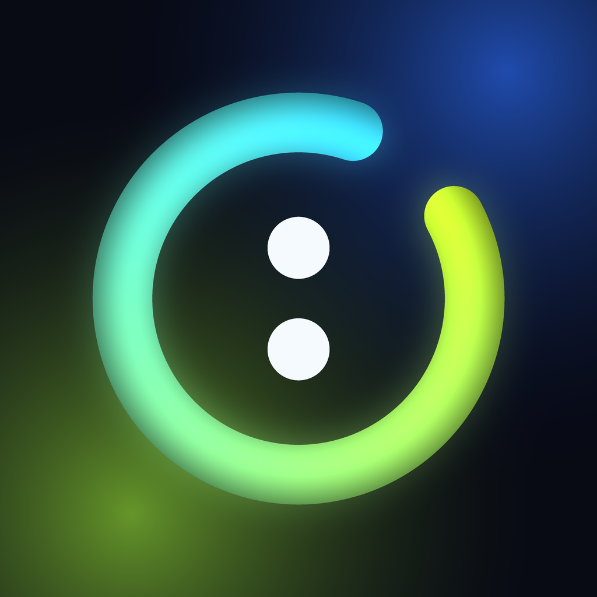

<p align="center">
  
</p>

<h1 align="center">RE:SET AI</h1>

<p align="center">A health app for a hectic schedule. It tracks by itself and tells you one next step.</p>

## Overview

Native iPhone app. SwiftUI, SwiftData, local first. No account, no server. Your phone collects the data. Rules turn it into guidance. AI only helps read food and answer chat.

Design rule: the app removes work. It never adds it.

* Work, university and gym time record themselves from places you save.
* Steps, workouts and sleep come from Apple Health.
* Food is logged by describing it, photographing it or scanning a barcode.
* Reminders follow your own habits, such as the time you usually eat lunch.
* Missing data shows as missing. Nothing is guessed. Nothing is shaming.

## Features

### Today
* One priority sentence.
* Work, university and gym rows. Each shows start to end and the total, for example `09:02 to 17:40` and `8h 38m`.
* Food, water, steps, sleep and recovery at a glance.
* Floating log bar: describe, photo, barcode.
* Can I eat this?

### Activity
* Steps with a weekly chart, walk timer, workouts imported from Health.
* Workout planner. Reset clears the plan. Can't today gives a walk and a small food adjustment from today's log.

### Nutrition
* Calories and protein against your guide.
* Next meal card. Carb heavy day suggests protein. High fat suggests lean. Over the guide suggests a light meal.
* Water and caffeine. Caffeine from any logged drink is added by itself.

### Insights
* This week against last week.
* Patterns found in your own data, such as sleep after long work days and sleep after training. Shown only with enough days.

### Coach
* Chat that reads your data through a fixed set of tools. It cannot delete anything. Simple questions work with no AI.

### Also
* Widgets: Home Screen, Lock Screen, quick action.
* Siri and Shortcuts: log water.
* Liquid Glass design on iOS 26. Frosted material on earlier versions.

## How it works

* Places: search a name such as your gym or office. iOS region monitoring reports arrive and leave. No route is recorded.
* Gym visit of 20 minutes or more becomes a strength workout.
* Health wakes the app when a workout or sleep night arrives. It imports and removes duplicates.
* Meal reminders move to the median time you ate that meal over the last 21 days, after 3 logs.
* Calorie target: Mifflin St Jeor, activity multiplier, capped deficit. Protein default is 1.8 g per kg.
* Everything calorie related is an estimate and is labelled as one.

Full internals are in `BUILD.md` on disk. It is not tracked in git.

## Install

Needs Xcode 16 or newer and an iPhone running iOS 17 or newer.

```sh
open RESET.xcodeproj
```

1. Select the RESET target, Signing and Capabilities, choose your Team.
2. Change the bundle identifier to something unique.
3. Add the App Groups capability to both RESET and RESETWidgets with `group.com.rayyan.reset`. If you change the id, change it in `Shared/WidgetShared.swift` and both entitlement files.
4. Confirm HealthKit and Background Modes (Location updates, Background fetch).
5. Run on a simulator or a connected iPhone.

Geofence arrivals, Health data and the camera need a real iPhone. A free Apple ID works and expires after seven days.

## Test

```sh
cd ResetCore
xcodebuild test -scheme ResetCore -destination 'platform=macOS'
```

Backend proxy tests, if you use it: `cd backend && uv run pytest`.

## AI setup

AI is off until you allow it. Open Settings, AI and data sources, pick a provider, add your key, then turn on "Allow sending". Keys are stored in the iOS Keychain on the phone.

* Anthropic: default model `claude-haiku-5-5`, editable.
* OpenAI or compatible: you enter the model name. It must accept images.
* Proxy: your own https server holds the key. See `backend/`.

```sh
cd backend
cp .env.example .env     # set AI_PROVIDER, the provider key, model and PROXY_TOKENS
uv run uvicorn app.main:app --host 0.0.0.0 --port 8000
```

Serve the proxy over https. The app refuses plain http.

Without AI, barcode scan, USDA search results and local coach answers still work.

## Data and privacy

* All data stays on the iPhone. A readable CSV and JSON copy is kept in the Files app under RE:SET AI, RE-SET Data.
* No analytics, ads or tracking.
* AI receives only what you allow: the food text or photo you submit, your coach questions and summary figures the coach looks up (calories, steps, sleep, weight, hours at work and gym). It needs separate permission. Coordinates, place names and raw Apple Health records are never sent.
* Food search sends search words to USDA FoodData Central. Barcodes go to Open Food Facts.
* Delete or export data in Settings, Privacy and data.
* Privacy Policy, Consumer Health Data Policy and Terms of Use are in the app. Health data consent is asked separately on the first screen and can be withdrawn.

## Project layout

```
RESET/            iOS app target
  App/            entry point, tab router
  Features/       Today, Activity, Nutrition, Insights, Coach,
                  Sleep, Time, Recovery, Settings, Onboarding
  Services/       location, Health, notifications, Keychain, AI config
  Models/         SwiftData models
  Intents/        Siri and Shortcuts
RESETWidgets/     widget extension
Shared/           code compiled into app and widgets
ResetCore/        Swift package, pure logic, unit tested
backend/          optional FastAPI proxy
scripts/          fallback test and type check scripts
```

Rule: logic lives in `ResetCore`. Views call it. `ResetCore` has no UI, SwiftData or iOS dependency, so every rule is tested on a Mac.

## Limits

* Not yet run on a physical iPhone. Automatic features are unproven on hardware.
* iOS can delay or miss location events. Needs Always location and Background App Refresh. Times are estimates, not proof of hours worked.
* The phone cannot detect sleep. It needs an Apple Watch or another app writing to Health.
* Notifications are scheduled ahead and cannot show live numbers.
* Allergy checks match names only. Always read the label.
* Not medical advice. Estimates only.

## Before release

* Fill `publisher`, `contactEmail` and `governingLaw` in `RESET/Features/Settings/LegalView.swift`.
* Host the Privacy Policy on a public URL.
* Have a lawyer review the legal text.
* Replace the placeholder bundle id.

## Credits

Nutrition data: USDA FoodData Central (public domain) and Open Food Facts (ODbL).
